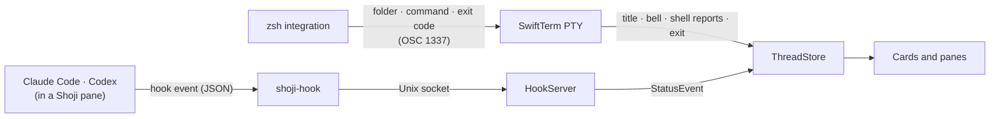

<div align="center">


# Shoji

*Hachi no Shoji · ハチの障子*

**A calm, native macOS home for the terminals you keep open all day.**

Coding agents like Claude Code and Codex sit next to long-running tasks like `pnpm dev`, and Hachi lets you know when one of them needs you.

[](https://github.com/yyyaaan/shoji/actions/workflows/ci.yml)


[](LICENSE)

</div>

<p align="center"></p>

## Why Shoji

Agent CLIs are at their best in a real terminal, but a dozen terminal tabs hide which agent is waiting on you. Shoji keeps every session (a **thread**) as a glass **card** on a **shelf**, opens the ones you are working with in **panes**, and shows at a glance which agent is working, done, or blocked on your answer.

Shoji is deliberately not an editor, a diff viewer or an agent client. It never talks to a model or an API: Claude Code and Codex stay plain CLIs on your own subscription, and Shoji only hosts their terminals and listens to their hooks.

## Features

- **Every thread is your shell.** ⌘N opens one next to the card you're on. `cd` anywhere, run `claude`, `codex` or `pnpm dev`, quit back to the prompt; the card follows along. While an agent runs, its card is named after what the agent is working on, with the folder underneath. Reopen Shoji and your threads, layout and Claude or Codex conversations come back.
- **Your shelf, your groups.** Drag cards into place and drop plain bars between them (right-click a card); groups mean whatever you want. Unnamed threads go by their folder's name, and get a number ("shoji 2") only when two would read the same.
- **Know who needs you.** Cards show working, needs you, done, idle, running and exited, each with its own shape and label. A needs-you card turns orange, counts what's waiting and brings out Hachi, who also peeks out under the window buttons: one click opens the thread that's waiting. With Shoji in the background, a macOS notification says which thread wants you (click it to go there; **Threads › Notify Me When Shoji Is Away** turns them off), and Hachi in the menu bar and the Dock badge keep the count. An agent that finishes while you're not looking keeps its tick and gets a soft ivory glow, like an unread mark, and Hachi too unless you turn off **Threads › Show Hachi When an Agent Finishes**.
- **Status from the CLI itself.** Claude Code reports through its own hooks, injected per launch with `--settings`, so your `~/.claude` is never touched. Shoji never scrapes terminal output.
- **Real terminals.** SwiftTerm with Metal rendering, your login shell's environment, 10,000 lines of scrollback, and Shift+Return for a new line in agent prompts.
- **Panes that stay out of the way.** Split any pane right, left, down or up (⌘D, ⇧⌘D, its header's Split menu, or drop a card on its edge); drag the gap between panes to resize; double-click a header to maximize; View › Arrange snaps back to one, two, three or four panes. Click a card to go to its thread (a line under the card means it's already in a pane); if it isn't on screen, it opens in the pane you're in. ⌥-click brings it to your pane, and dropping a card on a pane puts it exactly there, while a file dropped from Finder pastes its path, so a screenshot reaches Claude Code; other panes never change behind your back, so a dev server's log stays put. When you jump to a thread that's already on screen, its pane glows for a moment so your eye finds it. Hidden threads keep running, and ⌘Q only asks when quitting would stop something. No toolbar row: the shelf shares the top of the window with the window buttons.
- **Keyboard first.** ⌘K pops up a quick terminal in your thread's folder for a one-off like `open report.html`; close it and it's gone, unless something is still running, which becomes a thread. ⌃Tab flips back to the thread you were just in; hold ⌃ to keep going, like ⌘Tab. Jump to any card, cycle and split panes, or find the next agent waiting on you without touching the mouse. Press ⌘/ to see every shortcut.
- **Zoom everything.** ⌘+ and ⌘− scale terminal text and the glass chrome together, from 75% to 200%.
- **Native to macOS 26.** SwiftUI and Liquid Glass on the chrome, solid backgrounds behind terminal text.

> [!NOTE]
> Shoji is an early preview (v0). Folder, command and agent status need zsh (the macOS default). For Codex, run `/hooks` once in a Codex session inside Shoji and trust Shoji's hooks: Codex runs no hook you haven't reviewed.

## Requirements

- macOS 26 Tahoe or later
- [Claude Code](https://github.com/anthropics/claude-code) and/or [Codex](https://github.com/openai/codex) (a version with hooks; checked with 0.164) for live agent status
- To build: Xcode 27 (CI uses 27.1) and [XcodeGen](https://github.com/yonaskolb/XcodeGen)

## Install

### Build from source (recommended)

```sh
brew install xcodegen
git clone https://github.com/yyyaaan/shoji.git && cd shoji
scripts/package.sh                         # universal Release build and DMG
ditto build/Build/Products/Release/Shoji.app /Applications/Shoji.app
open /Applications/Shoji.app
```

Apps you build yourself open without a Gatekeeper prompt.

### Download

Every version merged to `main` publishes a DMG on [Releases](https://github.com/yyyaaan/shoji/releases). These builds are ad-hoc signed and not notarized, so macOS blocks the first launch: open **System Settings › Privacy & Security** and choose **Open Anyway**, or run `xattr -dr com.apple.quarantine /Applications/Shoji.app`.

## Keyboard shortcuts

| Action | Keys |
|---|---|
| New thread (next to the current card) | ⌘N |
| Quick terminal in this folder (closing keeps a running command as a thread) | ⌘K |
| Close thread (asks while something runs) | ⌘W |
| Jump to card 1–9 | ⌘1 … ⌘9 |
| Show a card in your pane (swaps if it's on screen) | ⌥-click the card |
| Previous thread (hold ⌃ to keep going, like ⌘Tab) | ⌃⇥ / ⌃⇧⇥ |
| Next thread that needs you | ⌘J |
| Next / previous pane | ⌘] / ⌘[ |
| Maximize or restore pane | ⇧⌘↩ |
| Split pane right / down | ⌘D / ⇧⌘D |
| Open the thread's folder in Zed or VS Code | ⇧⌘E |
| Arrange as one / two / three / four panes | ⌥⌘1 / ⌥⌘2 / ⌥⌘3 / ⌥⌘4 |
| Zoom in / out / actual size | ⌘+ / ⌘− / ⌘0 |
| All shortcuts | ⌘/ |

Shortcuts work while a terminal has focus. In agent prompts, Shift+Return inserts a new line.

## How it works



- Each thread is your login shell with `SHOJI_THREAD_ID` and `SHOJI_SOCKET` in its environment. For zsh, Shoji points `ZDOTDIR` at a tiny loader that restores yours, so your dotfiles load unchanged, then adds prompt hooks that report the folder and each command.
- Typing `claude` or `codex` in a thread runs it with Shoji's hooks for that run only (`--settings` for Claude, a `-c` override for Codex), so `~/.claude` and `~/.codex` are never touched. They call the bundled `shoji-hook`, which forwards the event to Shoji in about 10 ms and exits silently when Shoji isn't running, so it never slows the CLI.
- Every status change, from a hook or from the terminal, goes through one path into `ThreadStore`.
- No tmux, no multiplexer: threads persist through each CLI's own resume. On relaunch an agent thread runs `claude --resume <id>` or `codex resume <id>` at its first prompt; any other last command waits at the prompt for you to press Return.
- Shoji never types into a terminal on its own; anything it sends will come from an explicit click, showing exactly what it sends.

## Development

```sh
xcodegen generate     # after cloning and after any project.yml change
xcodebuild -scheme Shoji -derivedDataPath build -destination 'platform=macOS' -skipPackagePluginValidation test
open build/Build/Products/Debug/Shoji.app
```

`project.yml` is the source of truth; the Xcode project is generated and not committed. `-skipPackagePluginValidation` is needed because SwiftTerm runs a build-tool plugin; in Xcode, choose **Trust & Enable** once instead. Tests use Swift Testing, and CI runs them on every pull request and posts the results as a comment (`scripts/test-report.py`).

[AGENTS.md](AGENTS.md) is the contributor guide for people and coding agents alike: layout, conventions and the invariants that keep Shoji safe around your CLIs. [PLAN.md](PLAN.md) holds the current state, gotchas and decisions.

## Roadmap

- **Now (v0.4):** split panes in any direction, a ⌘K quick terminal, a menu bar Hachi, Dock badge and macOS notifications for threads that want you, files dropped onto a terminal paste their paths, open a folder in Zed or VS Code
- **Next and later:** a Settings window for terminal font, theme and scrollback; saved workspaces and multiple windows, including a slim sidebar style; a Hub view of every agent sorted by attention, with "Allow once"

The live list is in [PLAN.md](PLAN.md#tasks).

## About the name

Shoji (障子) are the paper sliding panels of a Japanese room: they let the light through and keep things quietly apart. **Hachi no Shoji** means *Hachi's shoji*. Hachi, an Akita, rests behind the panels and only peeks out when one of your threads needs you.

## Acknowledgements

- [SwiftTerm](https://github.com/migueldeicaza/SwiftTerm) by Miguel de Icaza (MIT) powers every terminal.
- Hachi, the Akita, was drawn for Shoji. Design sources live in [docs/design/hachi](docs/design/hachi/README.md).

## License

[Apache License 2.0](LICENSE)
