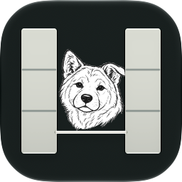
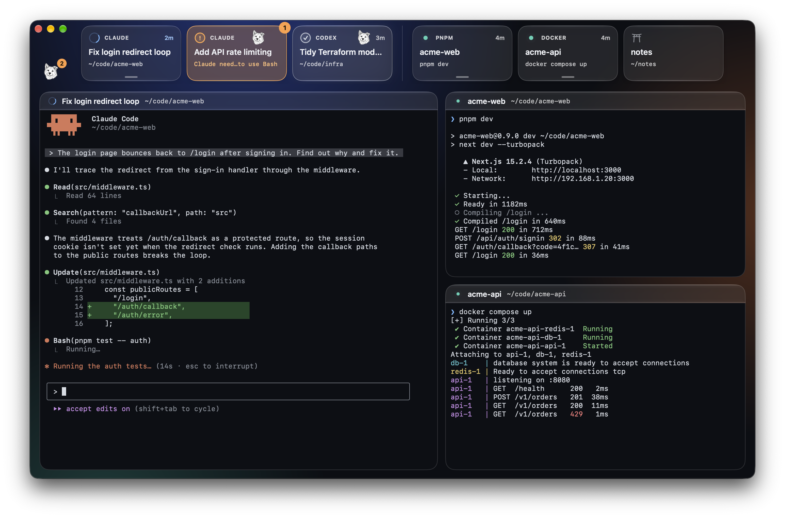
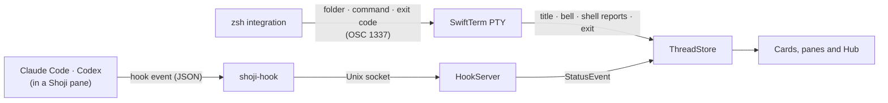

<div align="center">



# Shoji

*Hachi no Shoji · ハチの障子*

**A calm, native macOS home for the terminals you keep open all day.**

Coding agents like Claude Code and Codex sit next to long-running tasks like `pnpm dev`, and Hachi lets you know when one of them needs you.

[](https://github.com/yyyaaan/shoji/actions/workflows/ci.yml)


[](LICENSE)

</div>

<p align="center"></p>

## Why Shoji

Agent CLIs are at their best in a real terminal, but a dozen terminal tabs hide which agent is waiting on you. Shoji keeps every session (a **thread**) as a glass **card** on a **shelf**, opens the ones you are working with in **panes**, and shows at a glance which agent is working, done, or blocked on your answer.

Shoji is deliberately not an editor, a diff viewer or an agent client. It never talks to a model or an API: Claude Code and Codex stay plain CLIs on your own subscription, and Shoji only hosts their terminals and listens to their hooks.

## Features

- **Every thread is your shell.** ⌘N opens one next to the card you're on, and the stones under the lantern open one in any folder of, say, `~/code`. `cd` anywhere, run `claude`, `codex` or `pnpm dev`, quit back to the prompt; the card follows along, named after what an agent is working on. Reopen Shoji and your threads, layout and Claude or Codex conversations come back.
- **Know who needs you.** Every status has its own shape and label. A card that needs you turns orange and brings out Hachi, who also peeks out by the window buttons: one click opens it. Out of sight, a macOS notification says which thread wants you, and the Dock badge keeps the count. A finish you didn't see gets a soft ivory glow, like an unread mark.
- **Your shelf, your groups.** Drag cards into place and drop plain bars between them; groups mean whatever you want. Make a card mini, just its status and name down the side, for threads you keep around but rarely visit.
- **The Hub.** ⇧⌘H, or the lantern at the top right, swaps the panes for a card per thread, in your shelf's order: what it's waiting on or just did, its folder and git branch, its last lines, and one click into it. Esc goes back.
- **Panes that stay out of the way.** Split any pane in any direction (⌘D, ⇧⌘D, its header's menu, or drop a card on its edge) and drag the gaps to resize. Click a card to go to its thread; ⌥-click brings it to your pane, and dropping a card, or picking it from the chevron beside a pane's name, puts it exactly there. Other panes never change behind your back, so a dev server's log stays put. Files dropped on a terminal paste their paths, so a screenshot reaches Claude Code.
- **Beside your editor.** Put Shoji in Split View next to a full-screen Zed or Chrome and drag the divider narrow: it turns compact, one column of one or two terminals, each picking its thread from a dropdown. Widen it and your full layout is back.
- **Keyboard first.** ⌘K (or the bamboo at the top right) pops up a quick terminal in your thread's folder; ⌃Tab flips back to the thread you were just in, like ⌘Tab; ⌘J finds the next agent waiting on you. Hold ⌘ to see each card's number for ⌘1–9, and ⌘/ for every shortcut.
- **Sizes your way.** ⌘+ and ⌘− size the terminal text, View › Interface Size the chrome, and ⌥⌘+ / ⌥⌘− keep one pane bigger or smaller than the rest.
- **Real terminals, native chrome.** SwiftTerm with Metal, your login shell's environment, 10,000 lines of scrollback. Liquid Glass on the chrome; terminals sit on a dark background that lets a little of the window's light through, never blurred.
- **Status from the CLI itself.** Claude Code and Codex report through their own hooks, added per launch, so `~/.claude` and `~/.codex` are never touched. Shoji never scrapes terminal output.

> [!NOTE]
> Shoji is an early preview (v0). Folder, command and agent status need zsh (the macOS default). For Codex, run `/hooks` once in a Codex session inside Shoji and trust Shoji's hooks: Codex runs no hook you haven't reviewed.

## Requirements

- macOS 26 Tahoe or later
- [Claude Code](https://github.com/anthropics/claude-code) and/or [Codex](https://github.com/openai/codex) (a version with hooks; checked with 0.164) for live agent status
- To build: Xcode 27 (CI uses 27.1) and [XcodeGen](https://github.com/yonaskolb/XcodeGen)

## Install

### Build from source (recommended)

```sh
brew install xcodegen
git clone https://github.com/yyyaaan/shoji.git && cd shoji
scripts/package.sh                         # universal Release build and DMG
ditto build/Build/Products/Release/Shoji.app /Applications/Shoji.app
open /Applications/Shoji.app
```

Apps you build yourself open without a Gatekeeper prompt.

### Download

Every version merged to `main` publishes a DMG on [Releases](https://github.com/yyyaaan/shoji/releases). These builds are ad-hoc signed and not notarized, so macOS blocks the first launch: open **System Settings › Privacy & Security** and choose **Open Anyway**, or run `xattr -dr com.apple.quarantine /Applications/Shoji.app`.

## Keyboard shortcuts

| Action | Keys |
|---|---|
| New thread (next to the current card) | ⌘N |
| Quick terminal in this folder (closing keeps a running command as a thread) | ⌘K |
| Close thread (asks while something runs) | ⌘W |
| Jump to card 1–9 (hold ⌘ to see the numbers) | ⌘1 … ⌘9 |
| Hub (Esc goes back) | ⇧⌘H |
| Show a card in your pane (swaps if it's on screen) | ⌥-click the card |
| Previous thread (hold ⌃ to keep going, like ⌘Tab) | ⌃⇥ / ⌃⇧⇥ |
| Next thread that needs you | ⌘J |
| Next / previous pane | ⌘] / ⌘[ |
| Maximize or restore pane | ⇧⌘↩ |
| Split pane right / down | ⌘D / ⇧⌘D |
| Open the thread's folder in Zed / VS Code | ⇧⌘E / ⌥⇧⌘E |
| Arrange as one / two / three / four panes | ⌥⌘1 / ⌥⌘2 / ⌥⌘3 / ⌥⌘4 |
| Terminal text bigger / smaller / actual size | ⌘+ / ⌘− / ⌘0 |
| This pane's text bigger / smaller / like the others | ⌥⌘+ / ⌥⌘− / ⌥⌘0 |
| All shortcuts | ⌘/ |

Shortcuts work while a terminal has focus. In agent prompts, Shift+Return inserts a new line.

## How it works



- Each thread is your login shell with `SHOJI_THREAD_ID` and `SHOJI_SOCKET` in its environment. For zsh, Shoji points `ZDOTDIR` at a tiny loader that restores yours, so your dotfiles load unchanged, then adds prompt hooks that report the folder and each command.
- Typing `claude` or `codex` in a thread runs it with Shoji's hooks for that run only (`--settings` for Claude, a `-c` override for Codex), so `~/.claude` and `~/.codex` are never touched. They call the bundled `shoji-hook`, which forwards the event to Shoji in about 10 ms and exits silently when Shoji isn't running, so it never slows the CLI.
- Every status change, from a hook or from the terminal, goes through one path into `ThreadStore`.
- No tmux, no multiplexer: threads persist through each CLI's own resume. On relaunch an agent thread runs `claude --resume <id>` or `codex resume <id>` at its first prompt; any other last command waits at the prompt for you to press Return.
- Shoji never types into a terminal on its own; anything it sends will come from an explicit click, showing exactly what it sends.

## Development

```sh
xcodegen generate     # after cloning and after any project.yml change
xcodebuild -scheme Shoji -derivedDataPath build -destination 'platform=macOS' -skipPackagePluginValidation test
open build/Build/Products/Debug/Shoji.app
```

`project.yml` is the source of truth; the Xcode project is generated and not committed. `-skipPackagePluginValidation` is needed because SwiftTerm runs a build-tool plugin; in Xcode, choose **Trust & Enable** once instead. Tests use Swift Testing, and CI runs them on every pull request and posts the results as a comment (`scripts/test-report.py`).

[AGENTS.md](AGENTS.md) is the contributor guide for people and coding agents alike: layout, conventions and the invariants that keep Shoji safe around your CLIs. [PLAN.md](PLAN.md) holds the current state, gotchas and decisions.

## Roadmap

- **Now (v0.6):** the Hub, mini cards, and a corner of zen controls: the Hub, a new thread in any folder, the quick terminal
- **Next:** "Allow once" from the Hub, and a signed, notarized build

The live list is in [PLAN.md](PLAN.md#tasks).

## About the name

Shoji (障子) are the paper sliding panels of a Japanese room: they let the light through and keep things quietly apart. **Hachi no Shoji** means *Hachi's shoji*. Hachi, an Akita, rests behind the panels and only peeks out when one of your threads needs you.

## Acknowledgements

- [SwiftTerm](https://github.com/migueldeicaza/SwiftTerm) by Miguel de Icaza (MIT) powers every terminal.
- Hachi, the Akita, was drawn for Shoji. Design sources live in [docs/design/hachi](docs/design/hachi/README.md).

## License

[Apache License 2.0](LICENSE)
